# UML — NetControl

## 1. Visão geral

Este documento descreve o **diagrama de classes do NetControl**, com foco inicial no módulo **ACS**.

O modelo está dividido em dois domínios principais:

- `public`: núcleo compartilhado do NetControl;
- `acs`: entidades específicas do módulo ACS.

O diagrama abaixo utiliza **Mermaid Class Diagram**.

---

# 2. Diagrama de classes completo

```mermaid
classDiagram

direction LR

namespace Public {
    class User {
        +UUID id
        +string name
        +string email
        +string password_hash
        +boolean active
        +datetime created_at
        +datetime updated_at
    }

    class Role {
        +UUID id
        +string name
        +string description
        +datetime created_at
        +datetime updated_at
    }

    class Permission {
        +UUID id
        +string code
        +string description
        +datetime created_at
    }

    class UserRole {
        +UUID user_id
        +UUID role_id
    }

    class RolePermission {
        +UUID role_id
        +UUID permission_id
    }

    class SystemSetting {
        +UUID id
        +string key
        +json value
        +string description
        +boolean is_public
        +datetime created_at
        +datetime updated_at
    }

    class AuditLog {
        +UUID id
        +UUID user_id
        +string module
        +string action
        +string entity_type
        +UUID entity_id
        +json old_data
        +json new_data
        +string ip_address
        +datetime created_at
    }
}

namespace ACS {
    class Manufacturer {
        +UUID id
        +string name
        +string description
        +boolean active
        +datetime created_at
        +datetime updated_at
    }

    class RouterModel {
        +UUID id
        +UUID manufacturer_id
        +string name
        +string manufacturer_model_name
        +boolean supports_wifi_2_4
        +boolean supports_wifi_5
        +json supported_auth_modes
        +string product_class
        +string oui
        +string description
        +boolean active
        +datetime created_at
        +datetime updated_at
    }

    class RouterModelHardwareVersion {
        +UUID id
        +UUID router_model_id
        +string version
        +string description
        +boolean active
        +datetime created_at
        +datetime updated_at
    }

    class Firmware {
        +UUID id
        +UUID router_model_id
        +UUID hardware_version_id
        +string name
        +string version
        +string description
        +string file_path
        +string file_name
        +long file_size
        +string checksum_sha256
        +string release_notes
        +string status
        +boolean is_default
        +boolean active
        +datetime uploaded_at
        +datetime created_at
        +datetime updated_at
    }

    class Router {
        +UUID id
        +UUID router_model_id
        +UUID hardware_version_id
        +string name
        +string serial_number
        +string mac_address
        +boolean upnp_enabled
        +string description
        +string manufacturer
        +string oui
        +string product_class
        +string software_version
        +string hardware_version
        +string desired_status
        +string reported_status
        +datetime first_seen_at
        +datetime last_seen_at
        +datetime last_inform_at
        +string last_ip_address
        +UUID last_session_id
        +string last_contact_status
        +datetime created_at
        +datetime updated_at
    }

    class RouterWifiRadio {
        +UUID id
        +UUID router_id
        +string band
        +string ssid
        +int minimum_rssi_dbm
        +string wireless_mode
        +string security_mode
        +string encrypted_password
        +string authentication_mode
        +int channel
        +string channel_mode
        +int bandwidth_mhz
        +int transmit_power
        +boolean enabled
        +boolean visible
        +boolean client_isolation_enabled
        +boolean atf_enabled
        +datetime created_at
        +datetime updated_at
    }

    class RouterSession {
        +UUID id
        +UUID router_id
        +string protocol
        +string ip_address
        +string user_agent
        +string status
        +json inform_events
        +json metadata
        +datetime started_at
        +datetime finished_at
        +datetime created_at
    }

    class RouterCommand {
        +UUID id
        +UUID router_id
        +UUID created_by
        +string type
        +json parameters
        +string status
        +string priority
        +int attempts_count
        +int max_attempts
        +string idempotency_key
        +datetime available_at
        +datetime scheduled_at
        +datetime started_at
        +datetime last_attempt_at
        +datetime next_attempt_at
        +datetime completed_at
        +datetime expires_at
        +datetime canceled_at
        +string error_code
        +string error_message
        +json result
        +datetime created_at
        +datetime updated_at
    }

    class RouterCommandAttempt {
        +UUID id
        +UUID router_command_id
        +UUID session_id
        +int attempt_number
        +string status
        +json request_payload
        +json response_payload
        +string error_code
        +string error_message
        +int duration_ms
        +datetime started_at
        +datetime finished_at
        +datetime created_at
    }

    class RouterCommandEvent {
        +UUID id
        +UUID router_command_id
        +UUID created_by
        +string from_status
        +string to_status
        +string reason
        +json metadata
        +datetime created_at
    }

    class RouterBlacklist {
        +UUID id
        +string type
        +string value
        +string reason
        +boolean active
        +datetime expires_at
        +UUID created_by
        +datetime created_at
        +datetime updated_at
    }

    class RouterParameter {
        +UUID id
        +UUID router_id
        +string parameter
        +string value
        +string data_type
        +boolean writable
        +datetime collected_at
        +datetime created_at
    }

    class RouterEvent {
        +UUID id
        +UUID router_id
        +UUID session_id
        +string event_type
        +json payload
        +json metadata
        +datetime occurred_at
        +datetime created_at
    }
}

User "1" --> "0..*" UserRole : possui
Role "1" --> "0..*" UserRole : associado
Role "1" --> "0..*" RolePermission : possui
Permission "1" --> "0..*" RolePermission : associado
User "1" --> "0..*" AuditLog : gera

Manufacturer "1" --> "0..*" RouterModel : fabrica
RouterModel "1" --> "0..*" RouterModelHardwareVersion : possui
RouterModel "1" --> "0..*" Firmware : recebe
RouterModelHardwareVersion "1" --> "0..*" Firmware : compatibilidade
RouterModel "1" --> "0..*" Router : instancia
RouterModelHardwareVersion "0..1" --> "0..*" Router : hardware

Router "1" --> "0..*" RouterWifiRadio : possui
Router "1" --> "0..*" RouterSession : estabelece
Router "1" --> "0..*" RouterCommand : recebe
Router "1" --> "0..*" RouterParameter : reporta
Router "1" --> "0..*" RouterEvent : gera

RouterCommand "1" --> "0..*" RouterCommandAttempt : possui
RouterCommand "1" --> "0..*" RouterCommandEvent : histórico
RouterSession "0..1" --> "0..*" RouterCommandAttempt : executa_em
RouterSession "0..1" --> "0..*" RouterEvent : contém

User "0..1" --> "0..*" RouterCommand : cria
User "0..1" --> "0..*" RouterCommandEvent : altera
User "0..1" --> "0..*" RouterBlacklist : cria
```

---

# 3. Diagrama simplificado do módulo ACS

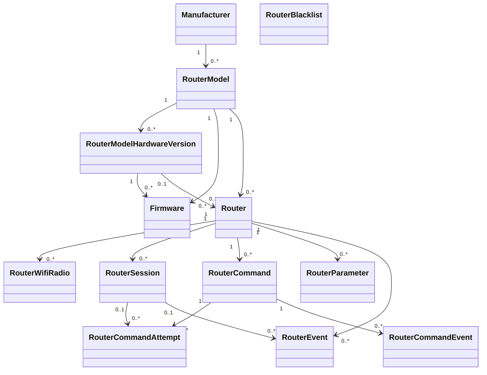

---

# 4. Núcleo do NetControl

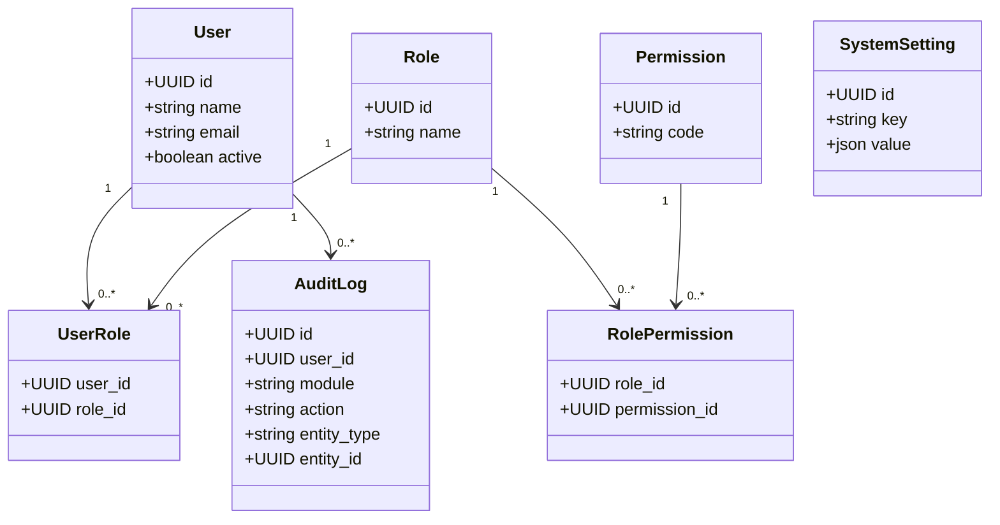

---

# 5. Classes do domínio ACS

## 5.1 Manufacturer

Representa o fabricante de equipamentos.

Exemplos:

- TP-Link;
- Huawei;
- Intelbras;
- ZTE;
- Nokia.

### Responsabilidades

- identificar o fabricante;
- agrupar modelos;
- permitir filtragem e organização.

---

## 5.2 RouterModel

Representa um modelo lógico de roteador.

Exemplo:

```text
TP-Link Archer C6
```

### Responsabilidades

- definir características do equipamento;
- informar bandas Wi-Fi suportadas;
- definir Product Class;
- armazenar dados de identificação do fabricante;
- servir como base para firmware e roteadores físicos.

---

## 5.3 RouterModelHardwareVersion

Representa uma versão física de hardware de um modelo.

Exemplo:

```text
Archer C6
├── V2
├── V3
└── V3.20
```

### Relacionamentos

```text
RouterModel 1:N RouterModelHardwareVersion
```

---

## 5.4 Firmware

Representa um firmware homologado ou disponível para um modelo.

### Relacionamentos

```text
RouterModel 1:N Firmware

RouterModelHardwareVersion 1:N Firmware
```

Um firmware poderá existir inicialmente sem arquivo associado.

---

## 5.5 Router

Representa um equipamento físico.

Exemplos:

```text
Cliente 10284
Loja Centro
POP Administrativo
```

### Principais identificadores

- serial;
- MAC;
- OUI;
- Product Class.

### Estado

Possui separação entre:

```text
desired_status
reported_status
```

Isso permite representar configurações ainda pendentes de aplicação.

---

# 6. Relação entre roteador e Wi-Fi

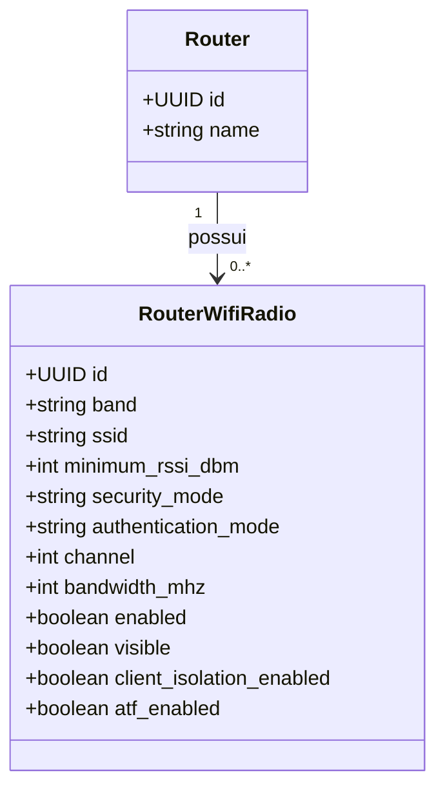

A mesma classe é utilizada para:

```text
2_4_GHZ
5_GHZ
```

E futuramente:

```text
6_GHZ
```

---

# 7. Fila de comandos

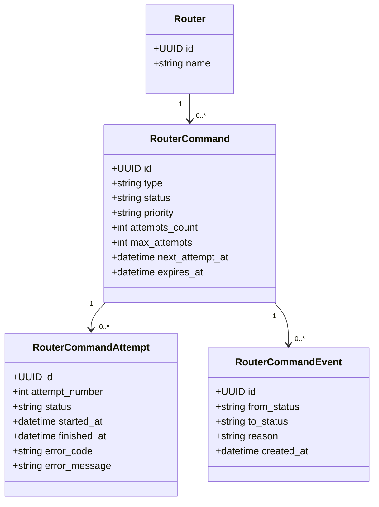

---

# 8. Ciclo de vida de RouterCommand

Estados:

```text
PENDING
SCHEDULED
WAITING_DEVICE
PROCESSING
RETRY_SCHEDULED
COMPLETED
FAILED
CANCELED
EXPIRED
```

Fluxo principal:

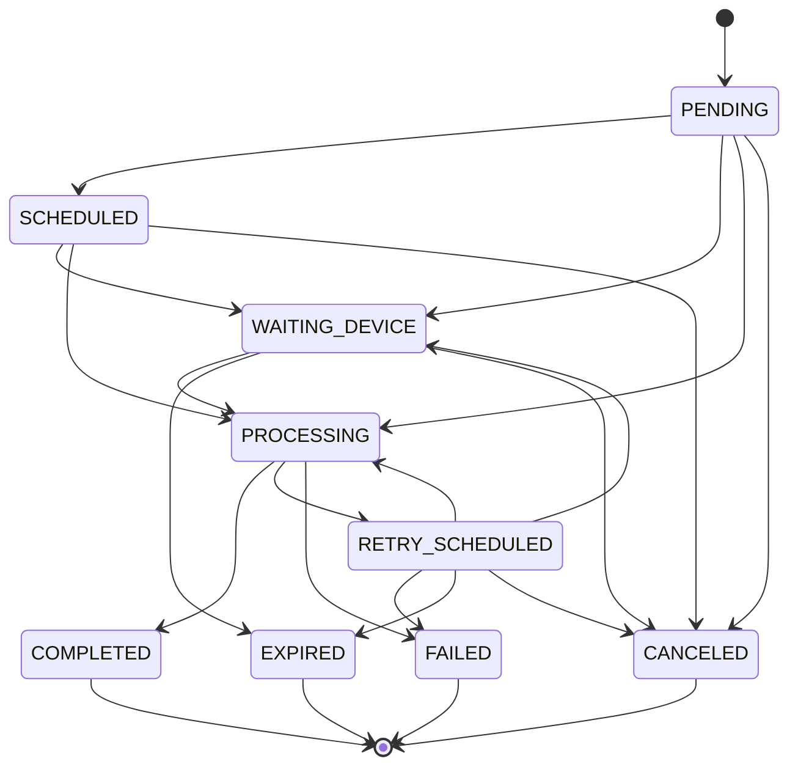

---

# 9. Tentativas de comandos

Cada `RouterCommand` pode possuir várias tentativas.

Exemplo:

```text
RouterCommand
└── REBOOT
    ├── Attempt #1 = TIMEOUT
    ├── Attempt #2 = CONNECTION_LOST
    └── Attempt #3 = SUCCESS
```

O status final do comando seria:

```text
COMPLETED
```

Enquanto o histórico continua preservado.

---

# 10. Sessões ACS

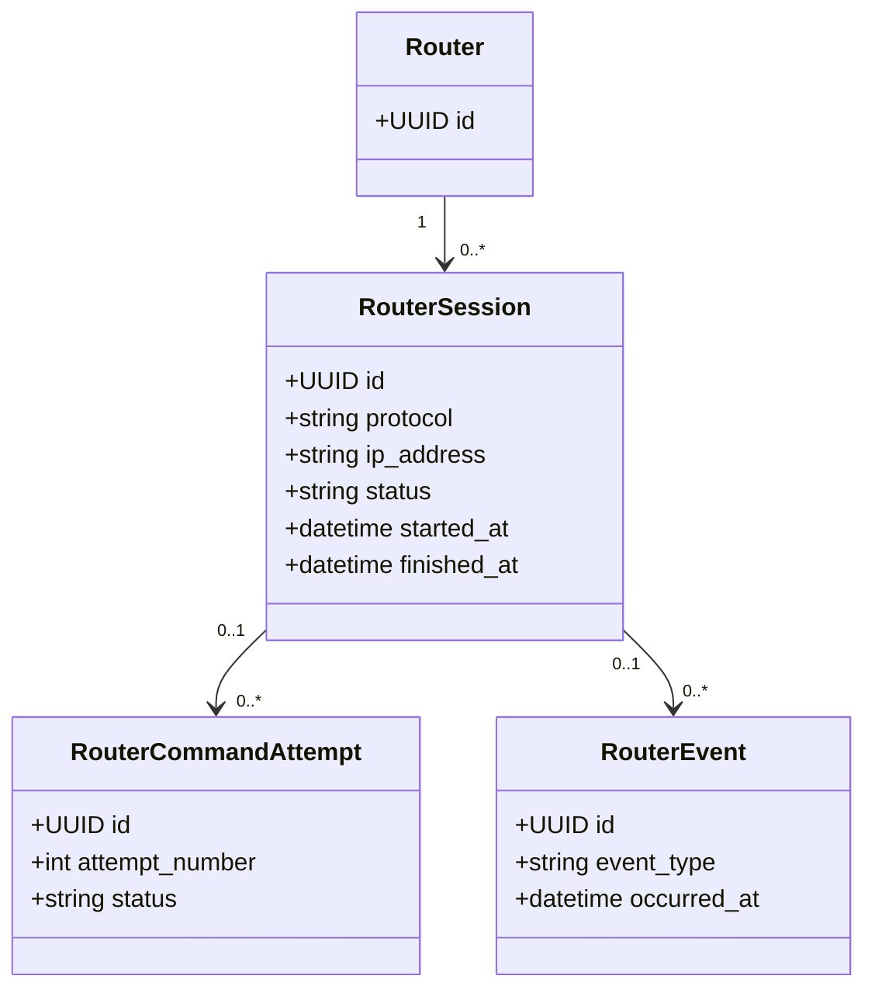

Uma sessão representa uma comunicação entre roteador e ACS.

Pode conter:

- Inform;
- leitura de parâmetros;
- execução de comandos;
- eventos;
- respostas;
- falhas.

---

# 11. Parâmetros do dispositivo

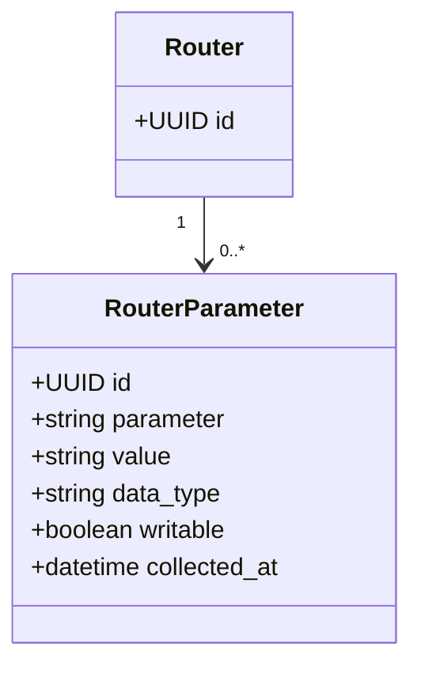

Exemplos:

```text
Device.DeviceInfo.SoftwareVersion

Device.DeviceInfo.UpTime

Device.WiFi.SSID.1.SSID

InternetGatewayDevice.DeviceInfo.SoftwareVersion
```

---

# 12. Eventos do dispositivo

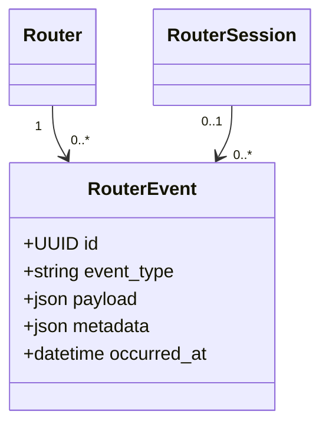

Tipos de eventos esperados:

```text
BOOT
BOOTSTRAP
PERIODIC
CONNECTION_REQUEST
VALUE_CHANGE
TRANSFER_COMPLETE
```

---

# 13. Blacklist

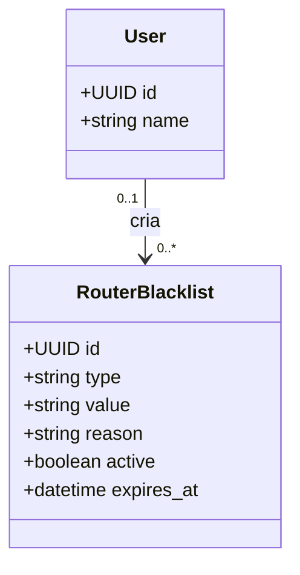

Tipos suportados:

```text
SERIAL_NUMBER
MAC_ADDRESS
OUI
IP_ADDRESS
PRODUCT_CLASS
```

A blacklist não possui relacionamento obrigatório com `Router`, pois deve ser possível bloquear um equipamento antes mesmo de ele ser cadastrado.

---

# 14. Multiplicidades principais

| Classe A | Relação | Classe B |
|---|---|---|
| Manufacturer | 1:N | RouterModel |
| RouterModel | 1:N | RouterModelHardwareVersion |
| RouterModel | 1:N | Firmware |
| RouterModelHardwareVersion | 1:N | Firmware |
| RouterModel | 1:N | Router |
| Router | 1:N | RouterWifiRadio |
| Router | 1:N | RouterSession |
| Router | 1:N | RouterCommand |
| Router | 1:N | RouterParameter |
| Router | 1:N | RouterEvent |
| RouterCommand | 1:N | RouterCommandAttempt |
| RouterCommand | 1:N | RouterCommandEvent |
| RouterSession | 1:N | RouterCommandAttempt |
| RouterSession | 1:N | RouterEvent |
| User | 1:N | RouterCommand |
| User | 1:N | RouterBlacklist |

---

# 15. Dependências entre schemas

O módulo ACS pode depender de entidades do núcleo.

Exemplo:

```text
public.users
      │
      ├── acs.router_commands.created_by
      │
      ├── acs.router_command_events.created_by
      │
      └── acs.router_blacklist.created_by
```

O caminho inverso deve ser evitado.

Ou seja:

```text
public
    ↓
independente dos módulos

acs
    ↓
pode utilizar public
```

O núcleo do NetControl não deve depender do módulo ACS.

---

# 16. Separação de responsabilidades

## `public`

Responsável por:

```text
autenticação
autorização
usuários
perfis
permissões
configurações
auditoria
```

## `acs`

Responsável por:

```text
roteadores
modelos
firmwares
Wi-Fi
sessões
parâmetros
eventos
comandos
tentativas
blacklist
```

---

# 17. Modelo conceitual resumido

```text
Manufacturer
    │
    └── RouterModel
          │
          ├── RouterModelHardwareVersion
          │       │
          │       └── Firmware
          │
          ├── Firmware
          │
          └── Router
                │
                ├── RouterWifiRadio
                │
                ├── RouterSession
                │      ├── RouterEvent
                │      └── RouterCommandAttempt
                │
                ├── RouterCommand
                │      ├── RouterCommandAttempt
                │      └── RouterCommandEvent
                │
                ├── RouterParameter
                │
                └── RouterEvent
```

---

# 18. Regras estruturais importantes

## 18.1 Firmware

Um firmware pertence a:

```text
1 RouterModel
```

E poderá pertencer a:

```text
0..1 RouterModelHardwareVersion
```

Dependendo da estratégia de compatibilidade utilizada.

---

## 18.2 Router

Um roteador pertence obrigatoriamente a:

```text
1 RouterModel
```

E pode possuir:

```text
0..1 RouterModelHardwareVersion
```

---

## 18.3 RouterCommand

Um comando pertence obrigatoriamente a:

```text
1 Router
```

Pode possuir:

```text
0..N RouterCommandAttempt
```

e:

```text
0..N RouterCommandEvent
```

---

## 18.4 RouterCommandAttempt

Cada tentativa pertence obrigatoriamente a:

```text
1 RouterCommand
```

Pode estar associada a:

```text
0..1 RouterSession
```

---

## 18.5 RouterBlacklist

Não deve possuir FK obrigatória para `Router`.

A identificação ocorre por:

```text
type + value
```

Exemplo:

```text
MAC_ADDRESS + AA:BB:CC:DD:EE:FF
```

---

# 19. Extensibilidade

O modelo deverá permitir futuramente adicionar classes como:

```text
RouterGroup
ConfigurationTemplate
FirmwareCampaign
ProvisioningProfile
MonitoringProfile
DiagnosticJob
ConnectedClient
WanInterface
LanInterface
```

Sem alterar o núcleo principal do domínio ACS.

---

# 20. Estrutura sugerida futura

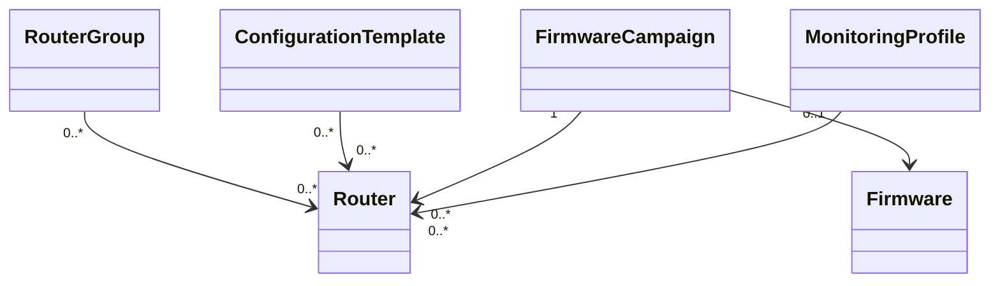

Essas classes não fazem parte do MVP atual, mas o modelo foi pensado para permitir essa evolução.